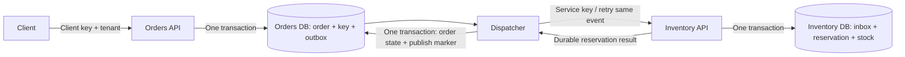

# Aether Commerce

A focused .NET 10 commerce backend demonstrating durable order submission, asynchronous inventory reservation, tenant-scoped API access, and retry-safe order completion. This is an evolution of an existing two-service outbox/inbox lab, not a complete online bookstore or a verified production deployment.

## Business capabilities

- Create single-SKU orders with tenant-scoped idempotency keys.
- Reserve stock atomically without allowing negative availability.
- Settle orders from `Pending` to `Confirmed` or `Rejected`.
- Recover from an ambiguous HTTP result by reading the durable reservation on replay.
- Retrieve order status and inspect available/reserved inventory.

No customer registration, catalog UI, cart, pricing, payments, refunds or book metadata is implemented. `Confirmed` means stock reserved; it does not mean paid or shipped.

## Stack and architecture

.NET 10 Minimal APIs, C#, Npgsql 10.0.3, PostgreSQL 17, Docker Compose, Python 3 standard-library API tests and GitHub Actions. There is no EF Core or frontend.



Preserving the existing deployment and database boundaries avoids a risky rewrite. These services demonstrate distributed failure handling; a new product of this size would ordinarily start as a modular monolith. See [architecture](docs/architecture.md) and [decisions](docs/architecture-decisions/001-preserve-boundaries.md).

## Repository structure

| Path | Responsibility |
| --- | --- |
| `src/Aether.Contracts` | HTTP/event records |
| `src/Aether.Orders.Api` | Order transaction and outbox worker |
| `src/Aether.Inventory.Api` | Inbox, reservations and stock |
| `src/Shared` | Linked HTTP hosting/security defaults |
| `db/init.sql` | Fresh database schema and ten-unit seed |
| `tests` | Executable HTTP tests and dependency audit gate |
| `docs` | Assessment, ADRs, development/API/demo guidance |

## Local setup

Install Docker with Compose, .NET 10 SDK for native builds, and Python 3 for tests.

```sh
cp .env.example .env
# Replace password/key placeholders with independently generated random values.
docker compose up --build -d
curl http://localhost:5101/health/ready
curl http://localhost:5102/health/ready
```

Use a random alphanumeric database password (at least 24 characters); generate each API key independently with at least 32 characters. `.env` is ignored. Do not use example values on shared hosts. Compose binds ports to loopback and retains the original PostgreSQL image-managed data volume configuration. Initialization runs only on an empty volume. Never remove a valuable volume to rerun initialization.

| Setting | Purpose |
| --- | --- |
| `POSTGRES_PASSWORD` | Local database password |
| `CLIENT_API_KEY` | Customer-facing Orders access |
| `SERVICE_API_KEY` | Internal Inventory access and worker credential |
| `TENANT_ID` | Tenant assigned to the client key; defaults to `demo` in Compose |
| `ConnectionStrings__Orders` / `ConnectionStrings__Inventory` | Native process connection strings |
| `InventoryBaseUrl` | Inventory address for the worker |

Native API keys use `Security__ClientKey`, `Security__ServiceKey`, and `Security__TenantId` environment names. See [development](docs/development.md).

## Try the API

Set `CLIENT_API_KEY` in your shell to the value from `.env` (Compose does not export it to your shell).

```sh
curl -i http://localhost:5101/orders \
  -H "X-Api-Key: $CLIENT_API_KEY" \
  -H 'Idempotency-Key: first-order' \
  -H 'Content-Type: application/json' \
  -d '{"tenantId":"demo","skuId":"11111111-1111-1111-1111-111111111111","quantity":2}'
```

Follow the returned `Location` with the same client key. Inventory is asynchronous, so the initial status is `Pending`. API reference and compatibility notes: [docs/api.md](docs/api.md). Failure exercises: [demo scenarios](docs/demo-scenarios.md).

## Verification

```sh
dotnet build src/Aether.Orders.Api -c Release
dotnet build src/Aether.Inventory.Api -c Release
python tests/run_security.py
# Only against a fresh disposable Compose database, with both keys exported:
INTEGRATION=1 python tests/api_tests.py
```

On Windows use `py` or your Python executable and `$env:INTEGRATION='1'`. Security tests start isolated API processes and need no database. The integration test consumes the seeded ten units; it must not run against personal or shared data. CI uses a fresh runner and executes the integration suite. CI is configured, but no GitHub workflow run is claimed.

## Security, reliability and performance

Fail-closed API keys, tenant checks, bounded payloads, parameterized SQL, rate limiting, generic ProblemDetails, trace IDs, database readiness and non-root containers provide a stronger demonstration baseline. API keys are a single-tenant demo identity mechanism; TLS termination, key rotation, OIDC/customer identity and role management remain deployment/product work. CORS is not enabled.

Existing unique constraints and conditional SQL updates protect idempotency and stock. Each worker claims one message per two-second tick to keep its three-second HTTP request within a thirty-second lease under ordinary operation. Lease ownership fences completion; pauses can still cause harmless duplicate delivery. This deliberately bounds throughput to approximately 0.5 messages/second/worker before latency and retries, not a measured benchmark. No caching, brokers or speculative repository abstraction was added.

## Limitations and roadmap

1. Execute the PostgreSQL integration and outage scenarios in Docker; review CI results before sharing the demo.
2. Add OIDC identities and tenant membership before serving multiple customers.
3. Add a book catalog and price snapshots, then carts and simulated payment workflows.
4. Add reviewed schema migrations before changing the initial schema; current changes require no schema migration.
5. Add dead-letter/reconciliation administration, retention and measured load testing before scaling dispatch.
6. Consider OpenTelemetry exporters only with an actual collection destination.

No real payment data is accepted. There are no benchmark claims or production-readiness claims. See [assessment and verification](docs/assessment.md) for evidence and remaining risks.
